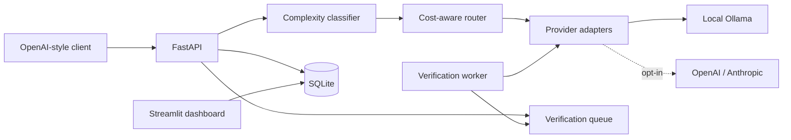

# LLM Cost Autopilot

A local-first LLM gateway that sends each prompt to the cheapest model likely to answer it well, then checks that choice against a stronger model and learns from the misses.

- **Routes by complexity.** A small classifier labels every prompt `simple`, `moderate` or `complex`; a rules file maps each label to candidate models, and the router picks the cheapest eligible one.
- **Verifies and escalates.** A higher-tier model re-answers the prompt in the background. If the two answers disagree beyond a per-task threshold, the stronger answer replaces the weaker one and the miss is recorded.
- **Learns from its mistakes.** Recorded misses are added to the classifier's training data, so the router improves on the prompts it got wrong.
- **Local by default.** Ollama models run on your machine. OpenAI and Anthropic adapters exist but are disabled until you opt in *and* provide a key.

> **No measured cost reduction yet.** `/v1/stats` reports estimated savings only once real requests exist, by repricing their recorded token counts at GPT-4o rates. Local models have a $0 API price, so any figure is a pricing-model estimate that ignores hardware and electricity. The [load-test report](docs/load-test-report.md) uses synthetic responses and says so.

## How it works



1. **Classify.** Six auditable features (length, instruction verbs, constraints, provided context, requested output format) feed a logistic-regression model.
2. **Route.** `configs/routing.yaml` lists candidate models per label. The router drops anything unavailable, ranks the rest by estimated cost, and falls back to lower tiers when needed.
3. **Call.** One normalized `Response` (text, tokens, latency, USD estimate) comes back from any provider.
4. **Verify.** A higher-tier model answers the same prompt, either in-process or via a separate worker draining a SQLite job queue. Extraction is scored field by field; other tasks use word overlap plus sequence similarity.
5. **Escalate and learn.** Below threshold, the stronger answer is returned and the prompt is stored as a routing failure labelled with the next tier up. The classifier retrains on those failures.

See [docs/architecture.md](docs/architecture.md) for the full request lifecycle, data model and design notes.

## Humans in the loop

The system pairs model judgement with human input at several points:

- **Human-labelled ground truth.** The classifier trains on 268 hand-labelled prompts (`data/complexity_examples.tsv`). Dataset gates reject unknown labels or fewer than 60 examples per tier.
- **Human ratings.** `POST /v1/feedback` stores a 1-5 rating and comment against any request, shown in the dashboard history. Ratings are recorded and reported but do not yet feed back into routing.
- **Human-authored checks.** The golden set (`data/golden_dataset.json`) defines deterministic pass/fail checks. An optional local LLM judge is scored separately and treated as untrusted, so a model never grades itself into a pass.
- **Human-controlled policy.** Routing candidates are editable at runtime through `PUT /v1/routing-config`, validated against the model registry and minimum quality tiers. Hosted spend needs an explicit opt-in.
- **Human review of failures.** `GET /v1/failures` and the dashboard show each routing miss with its quality gap, escalation model and extra cost.

## Quick start

Requires Python 3.11+ and [Ollama](https://ollama.com/).

```bash
python -m venv .venv && source .venv/bin/activate   # Windows: .venv\Scripts\activate
python -m pip install -e ".[dev]"

ollama pull llama3.2:1b    # simple prompts
ollama pull llama3.1:8b    # also the default local verifier for 1B answers

uvicorn app.main:app --reload          # API on :8000 (docs at /docs)
streamlit run dashboard/dashboard.py   # dashboard on :8501
```

Without the 8B model, send `"verify_quality": false` until a verifier is available.

### Docker Compose

```bash
docker compose up --build -d
docker compose exec ollama ollama pull llama3.2:1b
docker compose exec ollama ollama pull llama3.1:8b
```

Starts the API, a verification worker, the dashboard and Ollama. The SQLite database and live routing rules persist in the `autopilot_data` volume. Compose defaults to queued verification; for in-process verification set `LLM_VERIFICATION_MODE=inline` and `LLM_VERIFICATION_WORKER_ENABLED=false`.

### Try it

```bash
# OpenAI-style chat completion; the router picks the model, `model` is ignored.
curl -s localhost:8000/v1/completions -H 'content-type: application/json' -d '{
  "messages": [{"role": "user", "content": "Explain why leaves change color in autumn."}],
  "max_tokens": 300
}'

# See the routing decision without calling a model.
curl -s localhost:8000/v1/route -H 'content-type: application/json' \
  -d '{"prompt": "What is 6 multiplied by 7? Return only the number."}'
```

## API

| Endpoint | Purpose |
|---|---|
| `POST /v1/completions` | OpenAI-style chat completion with routing metadata. No streaming or tools. |
| `POST /v1/generate` | Route automatically or pin a `model_id`; optional `request_type`, `verification_budget_ms`. |
| `POST /v1/route` | Classify and show the routing decision. Calls no model. |
| `GET /v1/requests`, `GET /v1/requests/{id}` | History and the final verification result for a request. |
| `POST /v1/feedback` | Save a 1-5 rating for a request. |
| `GET /v1/failures` | Routing failures with quality gaps and escalation costs. |
| `POST /v1/evaluate` | Run the golden set; optional local `judge_model_id`. |
| `GET /v1/metrics` | Usage, cost, feedback, evaluation, queue and drift summaries. |
| `GET /v1/stats` | Estimated savings vs. GPT-4o from recorded tokens. `null` with no data. |
| `GET /v1/models` | Models, tiers, prices and routing eligibility right now. |
| `GET`/`PUT /v1/routing-config` | Read or replace candidate models per tier. |
| `GET /health` | Liveness. |

With `verification_budget_ms` at `0` (default) the first answer returns immediately and verification continues in the background; poll `GET /v1/requests/{id}` for the outcome. A positive budget waits up to that long and can return the escalated answer.

## Configuration

Copy `.env.example` to `.env` (Compose reads it; for a local run, export the variables).

| Variable | Default | Meaning |
|---|---|---|
| `LLM_ALLOW_PAID_PROVIDERS` | `false` | Opt in to hosted providers. Also needs the matching key. |
| `OPENAI_API_KEY`, `ANTHROPIC_API_KEY` | unset | Only set keys for providers you intend to use. |
| `OLLAMA_HOST` | `http://127.0.0.1:11434` | Local inference endpoint. |
| `LLM_AUTOPILOT_DB` | `data/autopilot.sqlite3` | SQLite path. |
| `LLM_ROUTING_RULES_PATH` | `configs/routing.yaml` | Writable rules file for live updates. |
| `LLM_VERIFICATION_MODE` | `inline` | `inline` (in the API process) or `queue` (separate worker). |
| `LLM_VERIFICATION_WORKER_*` | enabled, 0.5 s poll, 600 s lease | Worker behaviour. |
| `LLM_RETRAIN_INTERVAL_SECONDS` | `604800` | How often the API refits the classifier. |
| `AUTOPILOT_API_URL` | `http://127.0.0.1:8000` | Where the dashboard reaches the API. |

Hosted prices live in `data/pricing.json` and are estimates; verify before enabling paid calls. They were checked on October 20, 2026 against [GPT-4o](https://developers.openai.com/api/docs/models/gpt-4o), [GPT-4o-mini](https://developers.openai.com/api/docs/models/gpt-4o-mini), [OpenAI deprecations](https://developers.openai.com/api/docs/deprecations), [Claude Sonnet 5](https://www.anthropic.com/news/claude-sonnet-5), [Claude Haiku 5.5](https://www.anthropic.com/claude-haiku-5-5), [Llama 3.1](https://ollama.com/library/llama3.1) and [Llama 3.2](https://ollama.com/library/llama3.2). GPT-4o and GPT-4o-mini are listed as deprecated by OpenAI; update their entries before relying on them.

## Evaluation

**Classifier.** Stratified 80/20 hold-out on the hand-labelled set: **88.89% accuracy on 54 prompts**.

| actual \ predicted | simple | moderate | complex |
|---|---:|---:|---:|
| simple | 17 | 2 | 1 |
| moderate | 1 | 14 | 2 |
| complex | 0 | 0 | 17 |

Regenerate the report with `python -m scripts.train_complexity_classifier` (it also trains on routing failures stored in the database). The set is small and illustrative, so tune it on a representative workload before trusting routing in production.

**Golden set and drift.** `POST /v1/evaluate` runs the 5 golden cases through deterministic checks (`contains_all`, `exact_match`, `json_values`). Drift compares the newest 10 scores with the previous 10 and alerts on a drop of 0.15 or more, only after 20 scores exist. To add a case, append an object with a unique `case_id`, `prompt` and `checks` to `data/golden_dataset.json`; the test suite validates its shape.

**Provider benchmark.** `python -m benchmarks.run_benchmark` sends 10 prompts to every available model and writes JSON and CSV to `benchmark_results/`. Unavailable models are marked skipped. It records cost, tokens and latency but does not score quality.

**Load test.** `python -m benchmarks.run_load_test --requests 1000 --concurrency 16` drives the real API, classifier, router and SQLite with a deterministic stand-in for Ollama. Latency and tokens are synthetic. See the [sample report](docs/load-test-report.md) and read its evidence-class note first.

## Development

```bash
pytest -q                          # no Ollama or hosted APIs needed
ruff check . && ruff format --check .
```

CI runs the same checks on Python 3.11 and 3.12.

```text
app/          FastAPI service, routing and verification core, provider adapters, worker
benchmarks/   Provider benchmark and simulated load test
configs/      Routing rules
dashboard/    Streamlit app
data/         Labelled examples, golden set, prices, thresholds (see data/README.md)
docs/         Architecture notes and the sample load-test report
scripts/      Classifier evaluation CLI
tests/        Unit and integration tests with local doubles
```

To add a provider: implement `ProviderAdapter` in `app/providers/`, register it in `PROVIDERS` (`app/providers/unified.py`), and add the model to `data/models.json` and `data/pricing.json`.

## Design decisions

- **SQLite, not a server database.** One file serves the API, worker and dashboard; WAL mode lets them share it. Job claiming uses `BEGIN IMMEDIATE` and leases, so a crashed worker's job is retried. Past one host, move to Postgres.
- **A cheap agreement score, not an LLM judge.** Verification compares answers deterministically, which is fast, free and inspectable. It measures *agreement with a stronger model*, not truth.
- **Features, not embeddings.** Six readable features keep routing explainable and training instant. A fine-tuned encoder would likely classify better.
- **Features are computed, never stored.** Training and serving share one extractor, so they cannot drift apart.
- **Hosted calls are opt-in.** Two independent conditions (flag and key) must hold before money can be spent.

## Limitations and security

- The API has **no authentication**. Keep it on a trusted network. SQLite stores prompts and responses in plain text, so use synthetic or approved data when sharing.
- Verification agreement is a proxy for quality. The classifier and golden set are small portfolio baselines.
- Queue jobs have no maximum-attempt or dead-letter policy; a job that repeatedly kills the worker process would be retried indefinitely.
- Pre-call cost ranking uses a rough characters-to-tokens estimate and the weights in `routing.yaml`. Those weights make `/v1/route`'s `estimated_cost_usd` a ranking score rather than a bill. Completed calls use provider-reported tokens.
- No license file is included; choose one before distributing.
